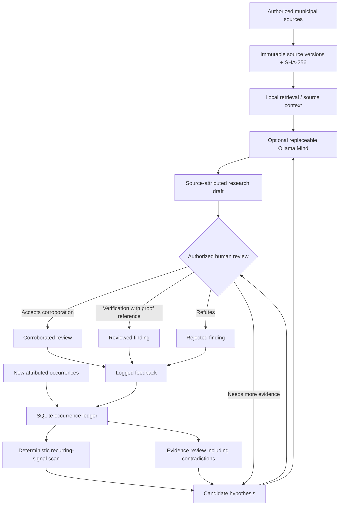

# AXIOM0 Living City v0.3 — Architecture

## Computational inheritance

| Historical construct | v0.3 treatment | Validation boundary |
|---|---|---|
| AXIOM0 Number System v0.1 | Original Python code preserved byte-for-byte | Numerical functions deterministic; no truth or prediction inference |
| SemiSoul continuity | Persistent Ed25519 identity and signed local event history | Local prototype only; no TPM/HSM, remote witness or key recovery |
| Replaceable Mind | Ollama model as optional, separately configured component | Mind output is a draft; model swap logged and does not change identity |
| MCAℓ atom | `Identity / Purpose / Observation / Constraint / Feedback` | Structured record, not cognitive or scientific proof |
| Charter governing oracle | Legal source index with authority, jurisdiction, version and date metadata | **No** automated legal precedence or case-law evaluation |
| Recursive Living City | Occurrence ingestion → grouped signal → hypothesis → evidence reassessment | Rules-based signals, **no** validated predictive model |
| Ezmerelda sensing philosophy | Observations require source, timestamp, provenance limitation | Sensor adapters and device migrations not included |

## Dataflow

All permanent changes append a signed audit event. Facts are not created by the LLM; documents are not treated as instructions to the model. Signed-history integrity can be compromised by full host compromise, key theft, or coherent database+key rollback without external witnesses.

## An epistemic state machine

- **Occurrence:** Attributed report, not accepted factual reality.
- **Candidate hypothesis:** An explanation or pattern worthy of testing.
- **Corroborated:** A human reviewer concluded that supporting evidence is adequate for this intermediate status.
- **Verified:** A human reviewer explicitly recorded a proof reference and rationale. Neither a signature nor a label magically makes the conclusion true.
- **Rejected:** A human reviewer documented reasons not to adopt the claim.

A recurring threshold cannot promote a candidate. Contradictory evidence is a first-class `stance` with a reason and audit trail; in a future implementation, independent source attestations and adversarial challenge workflows can be added.

## Authority and constitutional hierarchy

The City Charter is the principal local governing reference for Living City, but federal/state law, constitutional principles, enabling statutes, ordinance effective dates, and judicial decisions can control applicability. Merely indexing a Charter excerpt does not establish that it is operative or preempting any higher law. The present system stores cited texts and metadata but **does not make binding legal determinations**. City counsel and authorized clerks must review disputed precedence.

## Security boundaries

- Ed25519 identity key never sent to Ollama.
- Source text retrieval is bounded and sent only to the loopback API (`localhost:11434` by default).
- A local bearer API key protects business methods. A different reviewer key protects verdicts and Mind migration. These are not staff identity controls or organizational RBAC.
- There is no automatic access to the city's internal systems, no background scrapers, no internet/cloud model fallback, and no enforcement endpoint.
- Source logs require coarse-grained area categories, not person-level allegations.
- API exposes a local-only interface; production needs hardware-backed identity, remote audit witness, official IAM, service auth, TLS, user-level permissions and more rigorous source validation.

## v0.4 optional 3-6-9 intention tracker

The 3-6-9 Intention Lab uses separate `intention_*` tables and `369_*` signed events. It does not feed municipal observations, charter interpretation, ordinance findings, forecasting input, or harmony scores. See `INTENTION_369.md` for exact schedule, permissions and limitations.
