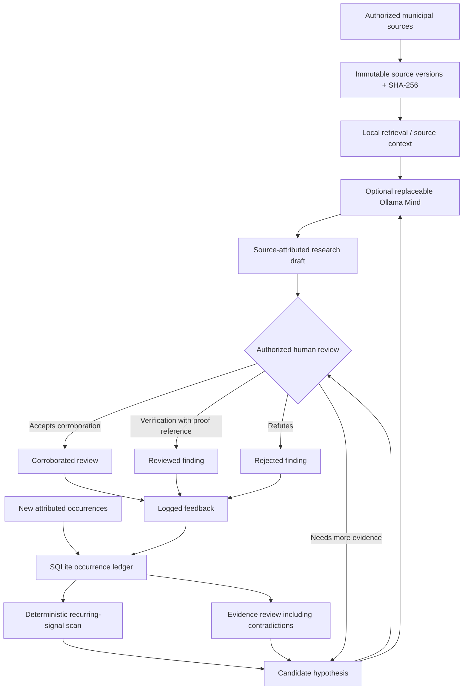

# AXIOM0 Living City v0.7 — Architecture

This page describes the current design. Version-specific changes are in `RELEASE_NOTES.md`.

## Computational inheritance

| Historical construct | Current treatment | Validation boundary |
|---|---|---|
| AXIOM0 Number System v0.1 | Original Python code preserved byte-for-byte | Numerical functions deterministic; no truth or prediction inference |
| SemiSoul continuity | Persistent Ed25519 identity, signed local event history, external anchor receipts | No TPM/HSM or key rotation; anchoring protects only history covered by a published receipt |
| Replaceable Mind | Ollama model as optional, separately configured component | Mind output is a draft; model swap logged and does not change identity |
| MCAℓ atom | `Identity / Purpose / Observation / Constraint / Feedback` | Structured record, not cognitive or scientific proof |
| Charter governing oracle | Legal source index with authority, jurisdiction, version and date metadata | **No** automated legal precedence or case-law evaluation |
| Recursive Living City | Occurrence ingestion → grouped signal → hypothesis → evidence reassessment; SPIKE-v2 service-request scan | Statistical signals (count model, seasonality, FDR control), **no** validated predictive model |
| Ezmerelda sensing philosophy | Observations require source, timestamp, provenance limitation | Sensor adapters and device migrations not included |

## Dataflow

All permanent changes append a signed audit event. Facts are not created by the LLM; documents are not treated as instructions to the model. Without external witnesses, someone with full control of the host could rewrite history coherently (database plus key). Published anchor receipts (`ANCHORING.md`) make that detectable for every anchored event.

## An epistemic state machine

- **Occurrence:** Attributed report, not accepted factual reality.
- **Candidate hypothesis:** An explanation or pattern worthy of testing.
- **Corroborated:** A human reviewer concluded that supporting evidence is adequate for this intermediate status.
- **Verified:** A human reviewer explicitly recorded a proof reference and rationale. Neither a signature nor a label magically makes the conclusion true.
- **Rejected:** A human reviewer documented reasons not to adopt the claim.

A recurring threshold cannot promote a candidate. Contradictory evidence is a first-class `stance` with a reason and audit trail; in a future implementation, independent source attestations and adversarial challenge workflows can be added.

## Authority and constitutional hierarchy

The City Charter is the principal local governing reference for Living City, but federal/state law, constitutional principles, enabling statutes, ordinance effective dates, and judicial decisions can control applicability. Merely indexing a Charter excerpt does not establish that it is operative or preempting any higher law. The present system stores cited texts and metadata but **does not make binding legal determinations**. City counsel and authorized clerks must review disputed precedence.

## Security boundaries

- Ed25519 identity key never sent to Ollama.
- Source text retrieval is bounded and sent only to the loopback API (`localhost:11434` by default).
- A local service key protects business methods. Reviewer actions (verdicts, Mind migration, queue review) need a reviewer key. Personal reviewer keys identify the reviewer by name, and the shared v0.6 key is recorded as `shared_key` and can be disabled. This is single-host identity, not SSO or organizational RBAC.
- There is no automatic access to the city's internal systems, no background scrapers, no internet/cloud model fallback, and no enforcement endpoint.
- Source logs require coarse-grained area categories, not person-level allegations.
- Feed fetching connects to the DNS address it validated (pinning); TLS still verifies the real hostname.
- API exposes a local-only interface; production needs hardware-backed keys, official IAM/SSO, TLS, user-level permissions and more rigorous source validation.

## Components added in v0.7

| Component | Module | Purpose |
|---|---|---|
| Schema migrations | `store.py` (`MIGRATIONS`) | Ordered, append-only, each recorded as a signed `schema_migrated` event; refuses newer data |
| Anchoring | `anchor.py`, `deploy/anchor/` | Signed head receipts to publish off-host; `anchor-verify` detects rewrite/rollback |
| Reviewer identities | `reviewers.py` | Personal keys (hash-only storage), enrolment/revocation ledgered, API derives reviewer from key |
| SPIKE-v2 | `spikes_v2.py` | Poisson / negative binomial tail test, seasonal baseline, Benjamini–Hochberg control |
| Retrieval for the model | `engine.search_documents` | BM25 with the same tokenizer as the quote path; excerpts centred on the best sentence |
| Backup / audit | `backup.py`, `tools/axiom0_audit_verify.py` | Consistent backup + verified restore; signed audit export verifiable without AXIOM0 |
| Grounding evaluation | `tools/eval_grounding.py` | Measures a real model's citation and refusal behaviour |

## Optional 3-6-9 module (off by default)

The 3-6-9 Intention Lab and `symbolic-state` scoring are a personal, optional module. They are **disabled unless `AXIOM0_ENABLE_SYMBOLIC=1`**: routes return 404, the dashboard hides the Lab, and CLI `369-*` commands refuse. When enabled, they use separate `intention_*` tables and `369_*` signed events and never feed municipal observations, charter interpretation, findings or forecasts. The 3·6·9 *inquiry* checklist (`inquire369`) is an evidence-review method and stays available. See `INTENTION_369.md`.
